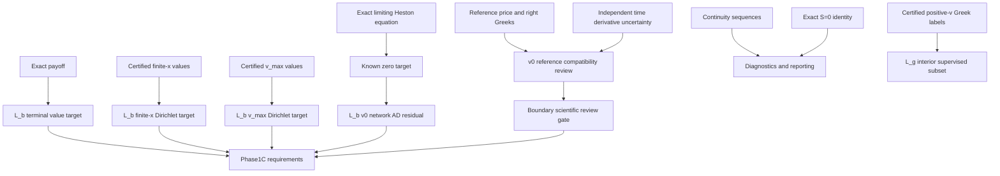

# Boundary evidence → training dependency

Phase1A의 L_b 목록 및 collocation specification을 감사했습니다. 새 Phase1C trainer는 아직 구현/실행되지 않았습니다. 아래는 intended dependency이며 현재 모델이 값을 소비했다는 runtime claim이 아닙니다.

network residual target=0이라는 L_b의 명시적 요구는 이미 존재합니다. reference에서 측정한 residual 값을 target으로 가져오는 연결은 없습니다.

예상 형태는 terminal/finite-trace value mismatch와 v0 AD equation penalty의 조합입니다. 이 도식이 새로운 BC weights, separate continuity loss, boundary derivative-supervision term을 정의하지는 않습니다. minibatch 제안은 terminal256, finite-x256, finite-v256이며 optimizer/weights의 최종 freeze는 미래 Phase1C 작업입니다.

의존성은 두 종류입니다. (1) 실제 target 공급: payoff 또는 certified price trace. (2) boundary equation이 reference model과 호환되는지 확인하는 사전 scientific review. 두 번째가 numerical residual label certification이라는 뜻은 아닙니다. 따라서 알고 있는 exact-zero target 자체가 불확실하다고 주장하지 않습니다.

가장 중요한 audit correction: L_b는 A(known zero limiting-equation penalty)와 finite-x/vmax pointwise value constraints를 사용합니다. C(standalone continuity regularization) 또는 D(separate v0 right-Vv supervision)는 선언되지 않았습니다. c_v^+는 network AD equation의 component이고, pointwise reference derivative는 equation compatibility의 audit evidence입니다. L_g의 Greek supervision은 training support v>=.01의 별도 항목입니다.

reference_v2의 compatibility 프로그램이 DIAGNOSTIC_ONLY라고 쓰는 것은 계산값을 아직 certificate로 승인하지 않았다는 뜻입니다. 원래 v0 boundary scientific obligation 전체가 L_b와 무관하다는 뜻은 아닙니다. 반면 continuity를 독립 numerical gate로 만든 v4 설명은 제거합니다. 이에 따라 최종 blocker는 limiting-PDE compatibility acceptance policy와 time uncertainty뿐입니다.
